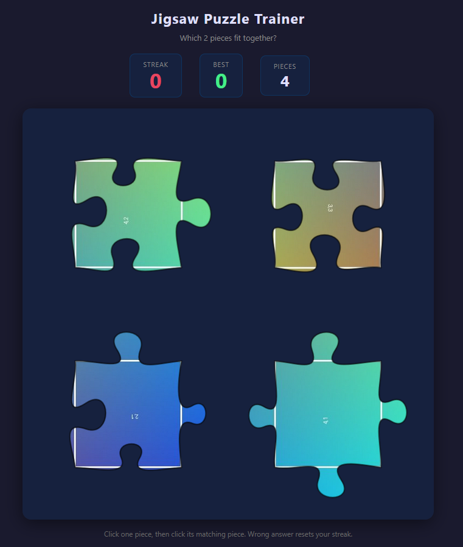

# Jigsaw Puzzle Trainer

**Live demo:** https://trainjigsaw.com

Train your eye for jigsaw puzzles. Each round presents a set of pieces — find the 2 that fit together based on their interlocking edges and colors. Chain correct answers to build your streak; one mistake resets it.

---

## How to play

1. Between **4 and 10 puzzle pieces** are shown on screen — exactly **2 of them fit together**.
2. **Click one piece** to select it (highlighted in yellow). Click it again to deselect.
3. **Click a second piece** to submit your answer.
   - **Correct** — streak increases and the next round loads automatically.
   - **Wrong** — the correct pair flashes green for 1.5 seconds, then your streak resets to 0.

Pieces are matched by their interlocking edge shapes (tabs and blanks) and color.

## Feedback & issues

Found a bug or have a feature idea? [Open an issue](https://github.com/rriquelme/Train_Jigsaw/issues) — all feedback welcome.
